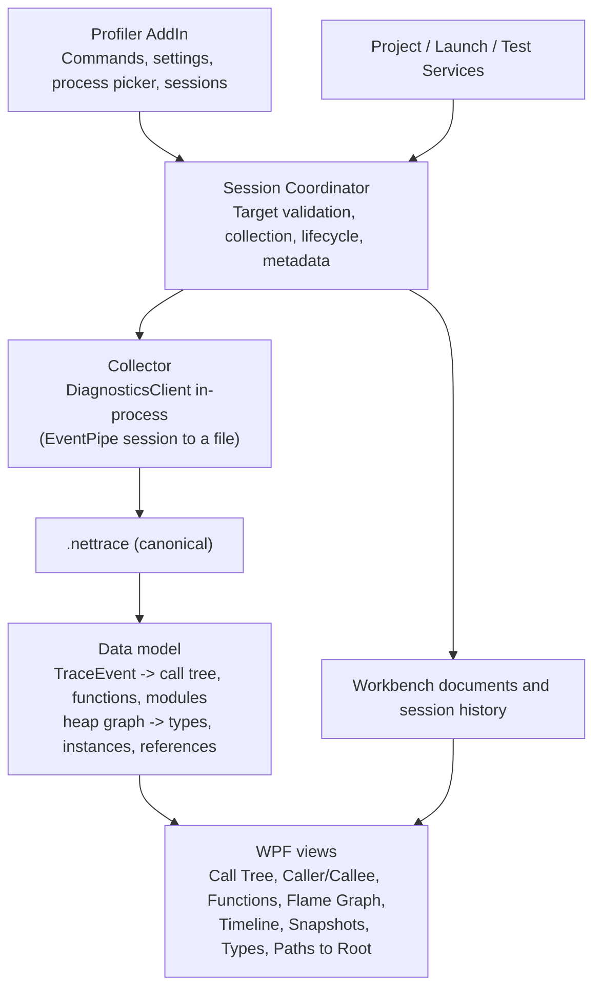

# OpenDevelop Profiler AddIn Modernization Proposal

**Status:** Implemented and verified on Windows (section 18). macOS and Linux unverified.  
**Date:** October 20, 2026  
**Target:** OpenDevelop (cross-platform LibreWPF-based IDE)  
**Scope:** Modern .NET CPU sampling and managed-heap snapshot analysis on Windows, macOS, and Linux  
**Primary recommendation:** Keep the SharpDevelop Profiler AddIn as the IDE integration point, replace its obsolete collection engine with official low-level .NET diagnostics components, and draw every report view ourselves in WPF/LibreWPF.

---

## 1. Executive Summary

OpenDevelop inherited a substantial Profiler AddIn from SharpDevelop. It provides a proven IDE integration model (menus, display bindings, workbench documents, call-tree context menus) and a set of reusable WPF controls. Its data-collection backend, however, relies on .NET Framework-era CLR profiling hooks, native DLLs, COM registration, shared memory, and a custom SQLite model. Restoring that engine conflicts with OpenDevelop's cross-platform and AnyCPU goals.

Decisions:

1. Keep the `Profiler.AddIn` identity and the workbench integration patterns.
2. Collect with **official low-level diagnostics libraries only**, in-process: `Microsoft.Diagnostics.NETCore.Client` (the library under `dotnet-trace`) to capture and `Microsoft.Diagnostics.Tracing.TraceEvent` to read. No external tool has to be installed, and no third-party viewers.
3. Keep `.nettrace` as the canonical artifact for both CPU samples and heap snapshots, readable by other tools independently of OpenDevelop. (`.gcdump` is not used: `TraceEvent` has no public reader for it; the heap snapshot is rebuilt from the runtime's GC heap-snapshot events, section 7.)
4. **Draw all reports in WPF/LibreWPF.** No WebView, no Speedscope, no dotnet-heapview, no Avalonia hosting. The view set and toolbar follow the Visual Studio profiler (section 5), using the Visual Studio glyphs the host already ships.
5. Reuse legacy controls only where they fit the new data model. The assessment (section 18.4) found `PercentBar` reusable as is and the ring diagram adaptable (and now adapted); the rest is bound to the old data model, so the new views are written against `CallTreeNode`.
6. Retire the native hook, shared-memory transport, and SQLite capture path.

This is an integration project with a self-built viewer, not a new sampling engine.

### Decision in one sentence

**Retain SharpDevelop's IDE-facing profiler shell; replace its profiling internals with official diagnostics libraries; render reports natively in WPF following the Visual Studio profiler's workflow.**

---

## 2. Goals, Non-Goals, and Acceptance Boundary

### 2.1 Goals

- Profile an OpenDevelop startup project, or attach to an existing supported .NET process.
- Collect CPU sampling profiles without a custom native profiler.
- Collect managed-heap snapshots and inspect them in native views.
- Write memory dumps of a running process, and open dumps from anywhere (a Windows dump, a Linux or macOS core file), read offline with ClrMD, in the same heap views plus a threads view (section 7.3).
- Same commands and session model on Windows, macOS, and Linux.
- Reuse the project system, launch configuration, add-in infrastructure, workbench documents, and Output/Error reporting.
- Keep captured files portable.
- Handle tool discovery, version checks, failures, cancellation, and diagnostic permissions explicitly.
- Keep the legacy sources for reference without forcing them into the active build.

### 2.2 Non-Goals for the first release

- Restoring the CLR Profiling API hook (`Hook32.dll`/`Hook64.dll`) or the SQLite model.
- A new sampling engine. Sampling is the runtime's EventPipe sample profiler.
- Exact method-entry counts or instrumented per-call durations.
- Native/OS/kernel profiling, machine-wide Linux profiling, GPU profiling, mixed native/managed stacks.
- Live allocation tracking, retained-size computation over very large heaps, leak detection beyond the simple insights in Phase 3.
- .NET Framework-only or Mono targets (EventPipe does not cover them).
- WebView hosting of any kind.
- Source-level navigation from every frame as an MVP criterion.

### 2.3 Supported target boundary

A **running CoreCLR-based .NET application with a usable diagnostic port**. UI framework is irrelevant: console, ASP.NET Core, and desktop apps use the same workflow. Permission, process identity, sandboxing, architecture, and disabled diagnostics can prevent attachment.

OpenDevelop's own designer and Hot Reload host processes are ordinary .NET processes. The attach picker must decide whether to list or hide them. Profiling a user's WPF/WinUI app must go through the same path as any other CoreCLR app; a .NET Framework WPF app is out of scope.

---

## 3. Current Codebase Findings

Observations from the repository (re-checked October 20, 2026). They describe source layout, not proof that the legacy profiler builds or runs.

### 3.1 Legacy add-in files under `src/AddIns/Analysis/Profiler/`

| Location | Current role | Recommendation |
|---|---|---|
| `Frontend/AddIn/ICSharpCode.Profiler.AddIn.addin` | AddInTree registration | **Keep identity, adapt registrations** |
| `Frontend/AddIn/Src/Commands/ProfileProject.cs`, `ProfileExecutable.cs` | Start profiling a project or executable | **Keep command intent; replace execution** |
| `Frontend/AddIn/Src/Commands/RunTestWithProfilerCommand.cs` | Profile selected tests | **Reintegrate later with current test infrastructure** |
| `Frontend/AddIn/Src/Views/ProfilerDisplayBinding.cs`, `ProfilingReportViewer.cs` | File association and workbench document | **Keep the pattern; add a `.nettrace` binding** |
| `Frontend/AddIn/Src/Views/ProfilerView.xaml` | Timeline, overview, Top 20, query tabs | **Rebuild around the new data model; reuse controls** |
| `Frontend/Controls/TimeLineControl`, `TreeListView`, `RingDiagramControl`, `QueryView` | WPF visualization | **Reuse where they fit; `QueryView` is coupled to the old data model** |
| `Frontend/AddIn/Src/Commands/GoToDefinition.cs`, `FindReferences.cs`, `FindCallsOfSelected.cs`, `SetAsRoot.cs`, `ShowFunctions.cs`, `CopyStacktrace.cs`, `CopySelectedData.cs` | Call-tree context menu actions | **Reimplement against Roslyn/editor services as the new data model allows** |
| `Frontend/AddIn/Src/ProfilerRunner.cs` | Legacy process and profiler lifecycle | **Replace, do not port** |
| `Controller/`, `Hook/`, `X64Converter/` | Native CLR profiler, IPC, SQLite model | **Retire** |

The legacy `QueryView` consumes `ProfilingDataProvider`, `CallTreeNode`, and a dynamically compiled C# query layer. It is not a drop-in viewer. The historical `Views/TODO.txt` lists a memory profiler as unfinished, and `ComparisonView` is largely a stub; neither is production functionality to preserve.

### 3.2 Build status

- The four profiler projects (`Controller`, `Frontend/AddIn`, `Frontend/Controls`, `X64Converter`) are listed in **`SharpDevelop.slnx`** but not in `OpenDevelop.Mvp.slnx`.
- They are .NET Framework 4.5 projects with `PlatformTarget` x86. That conflicts with the AnyCPU payload rules.
- **Phase 1 must decide their fate in `SharpDevelop.slnx`** (see section 12). The new add-in must be a new SDK-style project, not these files re-enabled.

---

## 4. Proposed Architecture



| Layer | Responsibility | Implementation |
|---|---|---|
| IDE integration | Commands, menus, target resolution, process picker, reporting | Modernized `Profiler.AddIn` |
| Session coordinator | Validate target, run collector, track state, write metadata, handle cancellation and errors | Thin new managed code |
| CPU collection | EventPipe sampling | `DiagnosticsClient` in-process (`CpuCapture`) |
| CPU data model | Aggregate sampled stacks into call tree, functions, modules, per-time-range views | `TraceEvent` reading `.nettrace`; new adapter code |
| Heap collection | Managed-heap snapshot | `DiagnosticsClient` with the GC heap-snapshot keywords (`HeapCapture`) |
| Heap data model | Types, counts, sizes (instances and referrers later) | Rebuilt from `GCBulkNode`/`TypeBulkType` events; the graph edges are not loaded yet |
| Visualization | All report views | WPF/LibreWPF, legacy controls reused where they fit |
| Persistence | Source artifacts plus small metadata | Normal files; **no custom profiling database** |

### 4.1 Design constraints

1. `.nettrace` stays authoritative; any internal cache is derived and replaceable.
2. No fork of `dotnet/diagnostics`.
3. A failed viewer or parser must not discard a completed capture.
4. Profiling must not silently edit project files or force artifacts into source control.
5. No WebView or non-WPF UI dependency.

---

## 5. Report Design (modeled on the Visual Studio profiler)

Source: Microsoft Learn, *Overview of the profiling tools*, *Measure CPU utilization*, *Measure memory usage*. VS itself can open traces collected by `dotnet-trace`, and documents that these are sampling results, not instrumented traces. This supports using `.nettrace` as the canonical sampled artifact.

### 5.1 Usage model

| VS entry point | OpenDevelop |
|---|---|
| Performance Profiler (Alt+F2): pick target and tool, start, stop, report | **MVP:** Profile Project / Attach, then report document |
| Diagnostic Tools window while debugging | **Later:** integrate with the sharpdbg debug session |
| Open a saved report | **MVP:** `.nettrace` file association |

Guidance to surface in the UI: profile **Release** builds; take several measurements because the first run includes JIT and load costs.

### 5.2 CPU views

| View | Content | Phase |
|---|---|---|
| **Call Tree** | Total CPU, Self CPU, Modules columns; Expand Hot Path; search | MVP |
| **Top Functions / Hot Path** | Functions ordered by cost; call stack of the hottest path | MVP |
| **Caller/Callee** | Current function in the centre; callers left, callees right; Function Body (self) share | MVP |
| **Timeline with range selection** | Select a range; all views recompute for it | MVP |
| **Show Just My Code** | Fold framework frames into one `[External Call]` node; off switch to expand | MVP |
| **Functions / Modules** | Aggregated by function or module | Phase 2 |
| **Flame Graph** | Custom `FrameworkElement` drawing rectangles by depth; zoom, tooltip, selection | Phase 2 |
| **Go to Source** | Resolve a frame to a method and open it in the editor, best effort | Phase 2 |

The flame graph is the one new graphical control that cannot be reused from the legacy add-in. Draw it with `DrawingContext`; thousands of rectangles are within WPF's reach.

### 5.3 Memory views

| View | Content | Phase |
|---|---|---|
| **Snapshots table** | One row per snapshot: Objects and Heap Size, each with change versus the previous snapshot | MVP |
| **Types view** | Type, count, size, inclusive size | MVP |
| **Instances view** | Instances of a selected type | Phase 2 |
| **Paths to Root / Referenced Types** | Who references the selection; what it references | Phase 2 |
| **Compare To** | Diff two snapshots, sorted by growth | Phase 2 |
| **Insights** | Event Handler Leaks (from the heap events); Duplicate Strings and Sparse Arrays on the Contents tab (from memory, section 7.4) | Phase 3 |
| **Memory dump** | A `.dmp` or core file opened as the Heap tab (every view above) and a Threads tab (threads, exceptions, stacks) | Phase 3 |

Show this warning before capture: collecting a managed-heap snapshot triggers a full (generation 2) garbage collection and may pause the target. A snapshot is a managed-heap graph, not a process memory dump or an allocation timeline.

### 5.4 Semantics to state in the UI

CPU sampling is statistical. Weight shown is sampled thread time, not exact instrumented time, and not exact call counts.

---

## 6. CPU Collection

**Decision (confirmed by the Phase 0 prototype):** collect in-process with `Microsoft.Diagnostics.NETCore.Client`'s `DiagnosticsClient`, the library underneath `dotnet-trace`. No separate tool has to be installed, Start and Stop are controlled by the IDE, and the file is complete before it is parsed.

### 6.1 Capture

`CpuCapture` (in `OpenDevelop.Profiler.Core`) opens an EventPipe session with two providers and streams it straight to `cpu.nettrace`:

- `Microsoft-DotNETCore-SampleProfiler` at informational level: the runtime's thread sampler.
- `Microsoft-Windows-DotNETRuntime` with the keyword set of `dotnet-trace`'s `dotnet-common` profile: the module-load and JIT events that name every sampled frame. The session also requests rundown so methods already loaded when the capture starts are named too.

The session ends on `StopAsync()`, after an optional duration, or when the target exits. In every case the file is complete when `Completion` finishes, and a target that exits mid-capture keeps what was written (the report says so in the status bar). Stopping a capture never ends an attached process.

### 6.2 Launching a project

`SuspendedLaunch` starts the process described by the project's launch settings (`AbstractProject.CreateStartInfo()`, so output assembly, working directory, arguments and environment come from the project system) with `DOTNET_DiagnosticPorts=<address>,suspend`. The runtime connects out to a diagnostic port the IDE listens on (`DiagnosticsClientConnector`) and waits there; the capture starts recording; then the runtime is resumed. The capture therefore sees the program from its first instruction. The launch is verified with a real diagnostics call before it is trusted, so a program that is not a .NET program, or ends early, produces a clear message instead of a hang.

A runtime that cannot be held at startup (older than .NET 5) falls back to `ProcessTargets.StartAndWaitForDiagnostics`: start the process and attach once its port answers, which misses the first moments. A project the Profiler started is ended when the capture stops; a process the user attached to is left running. The same launch path profiles unit tests: the Unit Tests pad's *Run with Profiler* starts the test host (the command line comes from `MtpTestProject.CreateTestHostStartInfo`, shared with the debugger) held at startup and samples it until it exits.

### 6.3 Parsing

`NettraceCpuReader` converts the file with `TraceLog.CreateFromEventPipeDataFile`, which resolves method names from the capture's own rundown events, and walks every sample's call stack into a `CpuProfile`: an interned frame table plus, per sample, a time, a thread, a state and a root-to-leaf stack of frame ids. The sample state is `Managed` or `External` (the thread was in native code or blocked); `External` samples are hidden by default because a parked thread is not CPU work.

Every report view is a pure function of the profile and a `ProfileFilter` (time range, thread, include-blocked, Just My Code), so range selection and Just My Code recompute from the samples with no cached state.

---

## 7. Memory Collection

**Decision (confirmed by the Phase 0 prototype):** a heap snapshot is the runtime's own GC heap-snapshot events, captured through `DiagnosticsClient` and kept as a plain `.nettrace` (`heap.nettrace`). The `.gcdump` format is **not** used: `TraceEvent`'s public API has no reader for it, and writing one would mean re-implementing an undocumented format. The events carry the same data.

### 7.1 Capture

`HeapCapture` enables the runtime provider with the `GCHeapSnapshot` keywords at verbose level. That makes the runtime run one full (generation 2) collection and emit the whole object graph as events (`TypeBulkType` for type names, `GCBulkNode` for each object, `GCBulkEdge` and the root events for references). The capture tees the stream to the file while reading it, and stops the session once the collection's stop event has arrived after the node events, or after a timeout (two minutes) or cancellation. The target is paused for the length of that collection, which the picker says before the user starts.

### 7.2 What is read

`NettraceHeapReader` aggregates the node events by type name into a `HeapSnapshot`: object count, shallow size and share of the heap per type, plus a per-type comparison between two snapshots. It also loads the edge and root events into a `HeapGraph` (compact arrays: every object's type, size and address, the references between objects, the GC roots). The graph answers who holds a type alive (shortest path from a root), what it holds, and, through a dominator tree computed off the UI thread, how much memory each type and instance keeps alive.

### 7.3 Memory dumps

A memory dump is the other source of a heap, and it carries what the GC events cannot: the objects' contents. Everything that reads one uses ClrMD (`Microsoft.Diagnostics.Runtime`, MIT), a deliberate exception to the rule of only using `DiagnosticsClient` and `TraceEvent`. It is isolated to three classes in `Core`, so it can be dropped without touching the EventPipe paths.

**Two ways in, one reader.**

| Way in | What happens |
|---|---|
| **Capture Memory Dump of Process...** | `DumpCapture` asks the runtime, over the diagnostic port, to write a dump with the heap (`DumpType.WithHeap`) into a new session as `process.dmp`, then opens it. The process is paused while the file is written; the picker says so, and the file is as large as the process's memory. |
| **Open Profiling Report...** or File > Open on a dump | The file is recognised by its header, not its name: `MDMP` for a Windows dump, an ELF header of type core for a Linux core file, a Mach-O header of type core for macOS. The display binding claims the usual names (`.dmp`, `.mdmp`, `.hdmp`, and a bare `core` or `core.1234`); a dump with another name opens through Open Profiling Report, which checks the header. |

**What `DumpReader` produces, in one walk of the heap.**

1. A `HeapSnapshot` with its `HeapGraph`, built from `ClrHeap.EnumerateObjects`, each object's reference addresses and `EnumerateRoots`, through the same graph builder the EventPipe reader uses. A dump therefore opens in the existing heap views unchanged: Types, Path to Root, Instances, retained size, Insights, and Compare To (a dump can be the baseline or the subject of a comparison with a snapshot).
2. The content findings (7.4), computed in the same walk by a `ContentScanner` that the opt-in scan after a snapshot also uses, so there is one definition of what a duplicate string or a sparse array is.
3. The managed threads: managed and operating system id, state (alive, finalizer, GC, dead), the exception being handled, and up to 200 frames of stack, top frame first.
4. What the dump is: the runtime version, the operating system and architecture it came from, and its size.

**The report.** `DumpReportView` has a header line and two tabs: **Heap** (the heap report, with the Contents tab) and **Threads** (the list, with the selected thread's stack below it; it opens on a thread that holds an exception, else on the live thread with the deepest stack). A dump is read offline: nothing is attached to and nothing is paused when one is opened.

**Limits and failure modes, stated in the product.**

- **The data access library.** ClrMD needs the runtime's own `mscordaccore` to read managed memory. It finds it beside the runtime in a full dump or on the machine; for a minidump, or a dump from another machine, it fetches it from the Microsoft symbol server, which needs a network. When it cannot, the error says so rather than reporting a generic failure.
- **Cross-platform.** A dump made on one operating system is readable on another where ClrMD and the matching library are available. Only Windows has been exercised (section 18.5).
- **Size.** The whole object graph is held in memory as arrays (several tens of bytes per object and a few per reference; not yet measured on a large dump); a heap of more than 20 million objects stops with a message instead of exhausting memory. The "large capture" warning applies at ten times its threshold for a dump, because a dump's size on disk (all native pages included) says little about the cost of reading its managed heap.
- **Not a dump.** A file that is not a dump is refused by its header before ClrMD sees it. ClrMD leaves a file it cannot open as a dump held open, which would block deleting it.
- **Native code.** Only managed objects and managed frames are read; native frames and native memory are not.
- **Privacy.** A dump contains the process's memory: strings, secrets, credentials. It is written to the session folder (or the folder chosen in Profiler Settings), never uploaded, and a dump written only to feed the opt-in content scan after a snapshot is deleted as soon as it has been read. Sessions of dumps are subject to the same retention as other captures.

### 7.4 Content insights

The GC heap events carry no object contents, so Duplicate Strings and Sparse Arrays come from reading memory. `ContentScanner` looks at each object as the heap is walked:

- **Duplicate strings.** Strings of at least eight characters are grouped by value (a 64-bit hash of up to the first 4,096 characters, so memory stays flat on a heap of millions of strings). A group with more than one member is reported with its copies and the bytes the extra copies waste, when that is at least 1 KB. The 100 largest are kept.
- **Sparse arrays.** A one-dimensional array of at least 16 elements whose elements are not structs, of which at least 90% are all-zero bytes (null for references, zero for numbers), and whose empty elements take at least 1 KB. An array over 64 MB is judged by its first 64 MB. The 100 largest are kept.

The result is a `ContentInsights` that is saved as `heap.contents.json` beside a heap snapshot, so a snapshot reopens with it. Reading it for a live process is **opt-in** (Profiler Settings: after a heap snapshot, also read the process's memory) because it pauses the process a second time and writes a temporary dump. A scan that fails does not fail the snapshot. A dump opened as a report always has the findings, since the walk is already being made.

---

## 8. Reusing the Old Profiler AddIn

### 8.1 Preserve

| Existing behavior | Modern behavior |
|---|---|
| Profile Current Project | Resolve launch target, start CPU workflow |
| Profile Executable | Resolve executable, arguments, working directory |
| `.sdps` display binding | Add a `.nettrace` binding; `.sdps` is not reinterpreted |
| `ProfilingReportViewer` lifecycle | Host the new report views as a workbench document |
| Call-tree context menu actions | Reimplement on the new data model and Roslyn services |
| Options panel | Tool paths, capture defaults, output location |
| Run with Profiler (tests) | Later phase, against current test infrastructure |

### 8.2 Retire

- `Controller/Profiler.cs`, `ProfilerRunner`, `Hook/`, COM registration, shared-memory transport.
- SQLite session writer/provider as the storage format.
- The CodeDOM query compiler tied to the historical call-tree records.
- x86 and .NET Framework 4.5 build assumptions.

Keep the legacy sources in a clearly marked legacy location until migration is validated. Do not delete them in the same change that adds the first working collector.

### 8.3 Details

- The old add-in requires the unit-testing add-in with preload. CPU and memory profiling must not depend on it; make test integration an optional registration.
- `.sdps` files are a separate historical format. Show an explicit "unsupported legacy format" message. Import is not an MVP requirement.

---

## 9. User Experience

### 9.1 Menus (Analysis > Profiler)

| Command | First-release behavior |
|---|---|
| Profile Current Project (CPU) | Bounded capture, then open the report document |
| Attach CPU Profiler to Process... | Pick process, capture, open report |
| Capture Managed Heap Snapshot... | Pick process, capture, add to the snapshots table |
| Capture Memory Dump of Process... | Pick process, write a dump with the heap into a session, open it (the process is paused meanwhile) |
| Open Profiling Report... | Open a `.nettrace` capture or a memory dump (`.dmp`, `.mdmp`, `.hdmp`, a core file) |
| Profiling Sessions | Recent sessions: open, reveal folder, delete |
| Profiler Settings... | Tool locations, duration, output location |

### 9.2 Session states

`Created -> Validating -> Collecting -> Finalizing -> Parsing -> Ready`; terminal states `Completed`, `Failed`, `Canceled`, and optionally `Partial` when a valid raw artifact exists after a parse failure. Never report success before checking the collector's exit status and output file. Canceling a collection must never terminate an externally attached target.

### 9.3 Reports as documents

Retain the `ProfilerDisplayBinding` / `ProfilingReportViewer` idea: a report is a workbench document containing the views from section 5, reopened from the raw file.

### 9.4 Source navigation

Best effort and not an MVP criterion. Inlining, generics, async state machines, native frames, and missing PDBs make exact mapping ambiguous. Unresolved frames must degrade gracefully.

---

## 10. Session Storage and Portability

```text
<workspace>/.opendevelop/profiling/
  <session-id>/
    session.json      # small OpenDevelop-only index (optional)
    cpu.nettrace      # raw CPU capture
    heap.nettrace     # raw heap snapshot (the GC heap-snapshot events)
```

- No custom profiling file format. `session.json` is an index only; damaged or missing metadata must not block opening raw files.
- Do not store environment variables, command-line secrets, or full exception output.
- Do not edit `.csproj` or `.gitignore` without consent. Offer an external data directory for read-only workspaces and attached processes.
- Provide delete and reveal actions; no silent automatic deletion.

---

## 11. Implementation Design

### 11.1 Components (recommendations, not existing APIs)

```text
Profiler.AddIn (modern SDK-style project, host-aligned target framework)
  Commands/       ProfileProject, AttachCpu, CaptureHeap, OpenReport
  Services/       ToolLocator, TargetResolver, SessionCoordinator,
                  CpuCollector, HeapCollector, SessionStore
  Model/          CpuProfile (call tree, functions, modules),
                  HeapSnapshot (types, instances, references)
  Views/          ProfilerSessionView, CallTreeView, CallerCalleeView,
                  FunctionsView, FlameGraphControl, SnapshotsView,
                  TypesView, ProfilerSettingsView, ProfilerDisplayBinding
  Integrations/   (later) TestProfilingAdapter, SourceNavigationAdapter
```

Do not pull the legacy `Profiler.Controller` project into this assembly.

### 11.2 Narrow interface

```csharp
public interface IProfilingCollector
{
    string Kind { get; }
    Task<ProfilingCaptureResult> CollectAsync(
        ProfilingTarget target,
        ProfilingOptions options,
        CancellationToken cancellationToken);
}
```

Follow existing OpenDevelop contracts for the exact types. The interface exists to isolate collection from menus and documents, not to create a general framework.

### 11.3 Target discovery and launch

There is no external tool to locate or version-check: the diagnostics client is a package reference of the add-in. What remains is finding processes and starting one.

- `ProcessTargets.ListManagedProcesses()` lists processes that publish a diagnostic port (`DiagnosticsClient.GetPublishedProcesses()`), excluding the IDE itself. The picker loads it off the UI thread because asking each process can be slow.
- `ProcessTargets.StartAndWaitForDiagnostics()` starts a process and waits for its port, with a clear failure for a program that cannot be started, exits early, or is not a .NET process.
- Failures of the diagnostics client are mapped to messages a user can act on (no diagnostic port, unsupported runtime, a timeout that usually means a different `TMPDIR` or a container boundary, access denied). `DOTNET_EnableDiagnostics=0` in the target also shows up as "no diagnostic port".

Start and attach never shell out: nothing is built from strings, so spaces and non-ASCII paths in the target are not a quoting problem.

### 11.5 Tests

Mock the process runner and file system for command construction, version discovery, state transitions, cleanup, and error reporting. Keep a small fixture process for end-to-end capture. Unit-test the aggregation (stacks to call tree, Total/Self, Just My Code folding, range selection) against small recorded traces.

---


## 12. Decisions

| Decision | Outcome | Notes |
|---|---|---|
| Legacy profiler projects in `SharpDevelop.slnx` | **Removed** from the solution; sources kept in place | The x86 .NET 4.5 projects conflict with the AnyCPU payload rules; the integration test project's own comment already listed them among the never-migrated add-ins |
| CPU collection | **`DiagnosticsClient` in-process** | Phase 0 prototype; the CLI is not needed |
| Heap snapshot | **GC heap-snapshot events kept as `.nettrace`** | No public `.gcdump` reader; ClrMD not needed |
| Add-in identity | **`Profiler.AddIn` preserved** | New SDK-style project beside the legacy folders |
| Capture control | **Start, and Stop or an optional duration** | The in-process path finalises the file on stop; the 15 s preset of the earlier draft is not needed |
| Just My Code rule | **Frames from the open solution's assemblies; framework heuristic when the profile contains none of them** | No symbol server |
| Toolbar and find | **One toolbar of Visual Studio glyphs; a floating find box over the call tree** | Section 18.3 |
| `.sdps` migration | Out of MVP | |
| Test integration | One phase later | |
| Source jump | Phase 2, best effort | |

---

## 13. Delivery Plan

### Phase 0: Feasibility gate: done

- A CPU `.nettrace` collected through `DiagnosticsClient` parses with `TraceEvent` into a correct call tree with Total and Self time.
- Heap parsing resolved: the GC heap-snapshot events (section 7).
- Verified on Windows. macOS and Linux still to verify, including `TMPDIR` and permission failure modes.
- Versions in use: `Microsoft.Diagnostics.NETCore.Client` 0.2.661903, `Microsoft.Diagnostics.Tracing.TraceEvent` 3.1.21 (both MIT).

### Phase 1: MVP: implemented on Windows

- New SDK-style `Profiler.AddIn` in the active build; legacy projects removed from the solution.
- Commands: Profile Project (CPU), Attach CPU, Capture Heap, Open Report, Settings.
- Session coordinator, storage, error reporting.
- CPU report: Call Tree, Top Functions/Hot Path, Caller/Callee, Timeline range selection, Show Just My Code.
- Memory report: Snapshots table, Types view.
- File associations and reopen after restart.

**Exit gate:** A user can profile, view, and reopen CPU and heap reports on the release platforms without the legacy engine.

### Phase 2: Depth: done

- Functions/Modules views and the Flame Graph control.
- Instances, Paths to Root / Referenced Types, snapshot Compare To.
- Go to Source (best effort).
- Session history view, safe Stop, "Profile Selected Tests".

### Phase 3: Expansion (each needs its own value review)

- Memory Insights: done. Event Handler Leaks (a heuristic on delegate targets) come from the heap events. Duplicate Strings and Sparse Arrays need object contents, which those events lack, so they are read from a memory dump with ClrMD (`Microsoft.Diagnostics.Runtime`, a deliberate exception to "DiagnosticsClient and TraceEvent only"); the scan is opt-in (Profiler Settings), pauses the process while its dump is written, and the dump is deleted after reading.
- Runtime counters and GC events: done. Captures record the `System.Runtime` counters once a second (CPU use, GC heap size, collections per generation, time in GC, allocation rate, exceptions, thread pool); the report has a Counters view on the same time axis as the samples.
- Allocation profiling (added in this phase): done. One sample per allocation tick, with the allocating stack and the allocated type; every call tree view works on it, measured in KB.
- Debugger-integrated profiling alongside sharpdbg: done. `IDebuggerService.DebuggedProcessId` (new) tells other tools which process the debugger is attached to; the DAP session records it for all three ways a session starts (attach, held launch, adapter launch via the `process` event). The profiler uses it for **Attach CPU Profiler to Debugged Process** (no picker) and to warn about a runtime paused at a breakpoint only when the process chosen is the debugged one.
- Remote/container diagnostic-port support: done as "Attach to Diagnostic Port": the IDE listens at an address and the program connects to it (`DOTNET_DiagnosticPorts`), so it needs no local process.
- Memory dumps: done. Write a dump of a running process and open any dump (Windows, Linux or macOS core) with ClrMD in the heap views, the content findings and a threads view (section 7.3). Verified on Windows with a dump of a real process; macOS and Linux dumps, minidumps without a local data access library, and very large dumps are not.

---

## 14. Acceptance Criteria

| ID | Scenario | Acceptance criterion |
|---|---|---|
| F-01 | Profile startup project | Resolved target runs and a valid raw `.nettrace` exists |
| F-02 | Attach to running process | Collector completes without terminating the target |
| F-03 | Call tree | Total and Self CPU are correct for a known fixture trace |
| F-04 | Just My Code | Framework frames fold into `[External Call]`; toggling off expands them |
| F-05 | Range selection | Selecting a time range recomputes all views for that range |
| F-06 | Heap capture | Snapshot saved; GC warning shown beforehand |
| F-07 | Snapshots table | Objects and Heap Size shown with change versus the previous snapshot |
| F-08 | Reopen | Existing `.nettrace` captures open without recollecting, including after restart |
| F-09 | Failure handling | Missing tool, incompatible target, permission failure, timeout give actionable messages |
| F-10 | Persistence | Raw files survive a parse or view failure |
| F-11 | Cancellation | Collector stops safely; attached app is not killed; partial files not mislabeled |
| F-12 | Old engine absent | MVP runs with no native hook, COM registration, or SQLite capture project |
| F-13 | Paths | Spaces and Unicode paths work on all target platforms |
| F-14 | Dump capture and open | A dump written from a running process opens as a report with the heap, the contents findings and the threads, and the process keeps running |
| F-15 | Not a dump | A file that is not a dump is refused with a message before any reader touches it, and is not left locked |
| F-16 | Dump without a data access library | The error names the missing runtime library and the symbol server instead of a generic failure |

Platform and workload validation: short and long-running console apps, ASP.NET Core under load, a desktop app, manually selected processes, diagnostics disabled or lacking permission, restart-and-reopen, and a heap capture under a substantial allocation workload.

---

## 15. Risks and Mitigations

| Risk | Impact | Mitigation |
|---|---|---|
| Heap parsing route unverified | Memory views blocked | Phase 0 prototype; ClrMD fallback |
| Adapter from trace to call tree is the main new code | Schedule | Prototype in Phase 0; unit tests on recorded traces |
| Flame graph is a new control | Phase 2 effort | Defer; Call Tree is the primary view |
| Paths to Root / inclusive size slow on large heaps | Unresponsive UI | Asynchronous computation; cap and progress UI |
| Legacy x86 projects in `SharpDevelop.slnx` | Payload and build breakage | Remove from the solution in Phase 1 |
| Misreading sampled time as exact | Misleading analysis | Explicit UI labels |
| Heap capture forces a full GC | Target pause | Warning, timeout, opt-in |
| Diagnostics blocked by permissions, `TMPDIR`, containers | Capture fails | Preflight and clear errors; defer remote support |
| Diagnostics tool flags or profile names change | Wrong command | Version detection; pin tested versions |
| Reports contain sensitive data | Privacy | Local-only handling; no uploads |
| A memory dump contains the process's memory (secrets, credentials) | Privacy | Written only to the session or chosen folder; never uploaded; a dump made only for the contents scan is deleted after reading; retention applies |
| A dump needs the matching `mscordaccore`, possibly from the symbol server | Dump cannot be read offline or without a network | The error names the cause; a full dump from the same machine needs nothing |
| A dump's object graph is held in memory | Out of memory on a huge heap | A 20-million-object cap with a message; the large-capture warning; streaming is future work |
| ClrMD is a second diagnostics stack beside `DiagnosticsClient` and `TraceEvent` | Dependency and version drift | Isolated to the dump reader, the content scanner and the content analyzer; the EventPipe paths do not use it |
| Restoring all old features at once | Delay | Phase gates |

---

## 16. Alternatives Considered

- **Port the whole SharpDevelop profiler.** Not recommended: native hook, COM, shared memory, SQLite, CodeDOM queries, and x86 .NET 4.5 projects.
- **Build a new add-in from scratch.** Not recommended: discards existing menus, documents, controls, and test precedents.
- **Third-party viewers (Speedscope, dotnet-heapview, PerfView, Profile Explorer).** Rejected by decision: we use only low-level components and draw the UI ourselves. This also removes the WebView, Avalonia, and associated license and packaging work.
- **MiniProfiler.** Not applicable: manual in-code instrumentation aimed at web requests, no attach, no CPU sampling.
- **CLI tools with no add-in.** Useful as a proof of concept, but loses project launch, reopen, and session handling.

---

## 17. References

### OpenDevelop and SharpDevelop

1. `src/AddIns/Analysis/Profiler/` (this repository)
2. `src/AddIns/Analysis/Profiler/Frontend/AddIn/ICSharpCode.Profiler.AddIn.addin`
3. [Original SharpDevelop Profiler source](https://github.com/icsharpcode/SharpDevelop/tree/master/src/AddIns/Analysis/Profiler)

### Diagnostics

4. [Microsoft Learn: dotnet-trace](https://learn.microsoft.com/en-us/dotnet/core/diagnostics/dotnet-trace)
5. [Microsoft Learn: dotnet-gcdump](https://learn.microsoft.com/en-us/dotnet/core/diagnostics/dotnet-gcdump)
6. [Microsoft Learn: Diagnostic Ports](https://learn.microsoft.com/en-us/dotnet/core/diagnostics/diagnostic-port)
7. [dotnet/diagnostics source](https://github.com/dotnet/diagnostics)

### Visual Studio profiler (design reference)

8. [Overview of the profiling tools](https://learn.microsoft.com/en-us/visualstudio/profiling/profiling-feature-tour)
9. [Measure CPU utilization in your apps](https://learn.microsoft.com/en-us/visualstudio/profiling/beginners-guide-to-performance-profiling)
10. [Measure memory usage in your apps](https://learn.microsoft.com/en-us/visualstudio/profiling/memory-usage)

## 18. Implementation Status (October 21, 2026)

### 18.1 What exists

| Piece | Where | State |
|---|---|---|
| Data layer: capture, parsing, aggregation, sessions, heap graph | `src/AddIns/Analysis/Profiler/Core/` (`net10.0`, no WPF) | Done |
| IDE add-in: commands, capture window, process picker, sessions window, report views | `src/AddIns/Analysis/Profiler/AddIn/` (`Profiler.AddIn`, in-process add-in) | Done; see 18.3 |
| Unit tests (143) | `tests/OpenDevelop.Profiler.Tests/` | Aggregation, sessions and pruning, comparison, heap graph, frame-name parsing, CSV export, plus real captures of a fixture process (attach, startup launch, diagnostic port, heap, allocations, counters) |
| Integration tests (22) | `tests/OpenDevelop.IntegrationTests/ProfilerIntegrationTests.cs` | Through the real IDE: open project, build, Profile Current Project and analyse the run; attach; report views, find, range; heap graph, retained size and compare; sessions window; reopen; launch from startup; Go to Source; profiling a test; an ASP.NET Core service under request load; a WPF application with a busy UI thread |
| Fixture programs | `tests/fixtures/ProfilerFixture/`, `ProfilerWebFixture/`, `ProfilerWpfFixture/` | A console program with a known hot method, live objects and startup work; an ASP.NET Core service; a WPF application with a busy UI thread |
| Legacy profiler | `Controller/`, `Frontend/`, `Hook/`, `X64Converter/` | Sources kept, removed from `SharpDevelop.slnx` |

The add-in keeps the `Profiler.AddIn` identity and the **Analysis > Profiler** menu: Profile Current Project (CPU), Attach CPU Profiler to Process, Attach CPU Profiler to Debugged Process, Allocation Profile Current Project, Attach Allocation Profiler to Process, Attach to Diagnostic Port, Capture Managed Heap Snapshot, Capture Memory Dump of Process, Profiling Sessions, Open Profiling Report, Profiler Settings. **Run with Profiler** is in the Unit Tests pad's context menu. `.nettrace` files open in the report view from the file system or File > Open.

### 18.2 Phase 0 results

- A CPU capture through `DiagnosticsClient` parses with `TraceEvent` into a correct call tree: on the fixture, the hot method holds 99% of samples and its caller is named correctly.
- Heap snapshots are rebuilt from the GC heap-snapshot events: the fixture's 12,345 held objects are counted exactly, the array holding them is found as their referrer, and a path from a GC root to them is found. A second snapshot of the same process shows no growth for that type.
- No public `.gcdump` reader exists in `TraceEvent`; the heap path therefore uses the events directly (section 7).
- A program can be held at startup through a diagnostic port (`DOTNET_DiagnosticPorts=...,suspend`) so the capture sees its first instruction; the fixture's work in its first 0.6 s is captured, which an attach afterwards cannot see.
- Both paths work on Windows. macOS and Linux are not yet verified; the code has no platform-specific parts apart from the diagnostic-port address (a pipe name on Windows, a socket path elsewhere), but the caveats of section 11.3 apply.

### 18.3 View set as built

| View | State |
|---|---|
| Call Tree (Total/Self time and share, percent bar, Module, Expand Hot Path, copy, context menu) | Done; opens with the hot path expanded |
| Functions (sortable by every column) | Done |
| Caller/Callee (with Back), side by side or stacked by pane width | Done |
| Flame Graph (click to zoom, right-click or Esc to zoom out, double-click for caller/callee) | Done |
| Ring Diagram (concentric rings of the call tree; click a slice to focus, click the centre or press Esc to go up, double-click for caller/callee) | Done; adapted from the legacy control |
| Timeline with range selection, thread filter, include-blocked, Just My Code | Done |
| Floating find box (Ctrl+F, F3, Shift+F3, Esc) over the call tree | Done |
| Go to Source from a frame (context menu in Call Tree and Functions) | Done, best effort: the frame name is mapped to a type and method and looked up through the Roslyn language service; lambdas and local functions map to the method that contains them; frames with no source in the solution report that |
| Heap: summary, Types table (count, size, share), type filter, compare with another snapshot | Done |
| Heap: Path to Root, Referenced By, References for the selected type | Done: shortest path from a GC root (breadth first), and the types that hold or are held by the type |
| Profiling Sessions window (open, show in folder, delete) | Done |
| Profile Current Project from startup | Done; falls back to attaching on a runtime that cannot suspend |
| Run with Profiler for selected tests (Unit Tests pad) | Done for Microsoft.Testing.Platform test projects; the test host is started held at startup and sampled until it exits |
| Heap: retained size per type and per instance, Instances tab | Done: the dominator tree is computed off the UI thread and the table fills in when it finishes |
| Heap: Insights (Largest retainers, Event handler targets) | Done. Event handler targets lists the types that delegates point at, which is where to look for subscriptions never removed; delegates are recognised by type name, so it is a heuristic. Duplicate Strings and Sparse Arrays come from the opt-in contents scan (a memory dump read with ClrMD), shown on the Contents tab |
| CPU compare with another capture (Functions view: change in each function's share of CPU time, in percentage points) | Done; matched on function and module name, so a renamed method shows as one that vanished and one that appeared |
| Allocation profile (attach; one sample per ~100 KB allocated, with the allocating stack and the allocated type as the leaf) | Done; every CPU view applies, measured in KB. Sizes are estimates, and small allocations can be missed |
| Counters view (CPU use, working set, GC heap size, collections per generation, time in GC, allocation rate, exceptions, thread pool, JIT) | Done for captures made by this version; older captures show a note |
| Export to CSV (call tree or function list; heap type table) | Done; numbers in the invariant culture, units in the column headings, UTF-8 with a byte order mark |
| Attach to Diagnostic Port (listen at an address; a program started elsewhere connects) | Done; for containers, forwarded sockets and service managers. The target is named by its host, since the protocol does not give a client its process id |
| Large capture warning (default 200 MB and over) | Done; asks before opening; the threshold is a setting |
| Views recomputed off the UI thread | Done: the call tree the report opens on, and every recomputation after a filter change on a capture of 100,000 samples or more (smaller ones recompute inline); a result a newer change has overtaken is dropped |
| Allocation profile from startup and for the current project (Analysis > Profiler > Allocation Profile Current Project) | Done; the same held-at-startup launch as the CPU profile |
| Profiler Settings (captures kept, large-capture threshold, store folder) | Done; stored in the IDE properties. Retention: starting a capture removes the oldest finished sessions beyond the newest N (default 30); the store folder defaults to `.opendevelop/profiling` in the solution folder |
| Debugger integration: Attach CPU Profiler to Debugged Process, and a warning when the chosen process is the debugged one and is stopped at a breakpoint | Done; when the debugger does not report its process the warning falls back to "the debugger is stopped" |
| Capture Memory Dump of Process | Done; writes a dump with the heap into a session and opens it; the process is paused meanwhile |
| Open a memory dump (Heap tab and Threads tab) | Done; read offline with ClrMD in one walk: types, object graph (Path to Root, Instances, retained size, Insights, Compare To), duplicate strings and sparse arrays, threads with exceptions and stacks. Recognised by header; the usual names and `core` bind the display |
The report toolbars use the Visual Studio Image Library glyphs the host already ships (`Resources/VS2026`), registered under `Profiler.*` in `PresentationResourceService`. Where the library has no equivalent (flame graph, just my code, blocked samples) the nearest glyph is used.

### 18.4 Reuse of the legacy controls: assessment

The legacy `Profiler.Controls` project is about 3,400 lines on .NET Framework 4.5 and x86. Most of it is bound to the old data model (`ProfilingDataProvider`, `CallTreeNodeViewModel`) or to its dataset-per-25-pixel timeline design.

| Legacy control | Lines | Coupling to the old model | Outcome |
|---|---|---|---|
| `PercentBar` | 47 | None | **Reused** (call tree percent column) |
| `HSVColor`, `PiePiece`, `RingDiagramControl` | 130, 167, 226 | Ring diagram needed `CallTreeNodeViewModel` (about 10 references) | **Adapted**: the colour model and wedge geometry are carried over, retargeted to `CallTreeNode`, and drawn by one element instead of one shape per slice |
| `HierarchyList`, `TreeListView` | 106, 55 | None / light | Not reused: equivalent to the expand/collapse logic written for the new tree, with a known O(N·M) cost |
| `TimeLineControl` | 392 | Light, but fixed 25 px pieces, scrolling, per-dataset events | Not reused: the new timeline fits the width and selects a range |
| `CallTreeNodeViewModel`, `QueryView`, `CustomGridView`, `CompareView` | about 1,800 | Heavy | Not reused: tied to the old data model and dynamic C# queries |

### 18.5 Known gaps and next steps

1. **macOS and Linux have not been run.** The code paths are the same, but the diagnostic-port discovery caveats (`TMPDIR`, containers) and the socket-based startup suspension are unexercised there.
2. **Content-based heap insights** (Duplicate Strings, Sparse Arrays) read a memory dump through ClrMD after the snapshot. They are opt-in (the process is paused again and a dump as large as its memory is written to the temporary folder), strings longer than 4,096 characters are compared by their first 4,096, and only the 100 largest findings of each kind are kept. Measured on Windows only.
3. **Heap snapshot size**: the capture file holds the whole graph (about 1.9 MB for 41,000 objects), and the graph is loaded fully into memory. A warning now precedes opening a capture of 200 MB or more; a streaming reader is not built, so a very large heap still needs memory several times its file size.
4. **Tests that use another test framework** are not profiled (only Microsoft.Testing.Platform projects are supported).
5. **Debugger integration** covers attaching to the debugged process and the breakpoint warning; it does not start a profiled run from a debug session, and a capture of a process stopped at a breakpoint records nothing until it continues.

---

### Interpretation note

The component versions, the call tree of the fixture process and the 12,345-object heap count were measured in this repository (section 18.2). Windows is the only platform exercised so far; nothing in the code is platform specific, but macOS and Linux have not been run.

---

## Final Recommendation

Keep the **Profiler AddIn** as the IDE shell and build on what is now in place: capture and parsing with the official diagnostics libraries, the `.nettrace` file as the portable record, and native WPF views that follow the Visual Studio profiler. The remaining work is verification on macOS and Linux (section 18.5). Do not restore the old CLR hook, the SQLite query engine or the .NET Framework controls.
